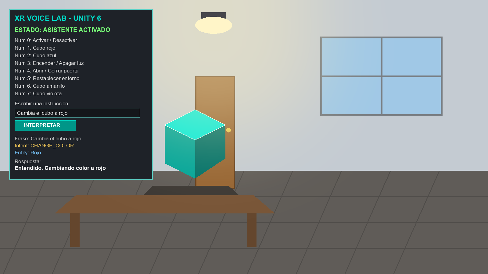
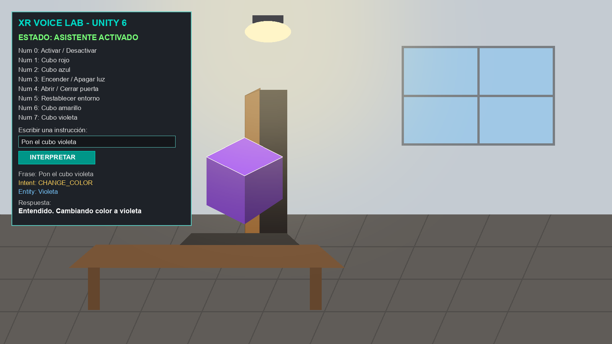
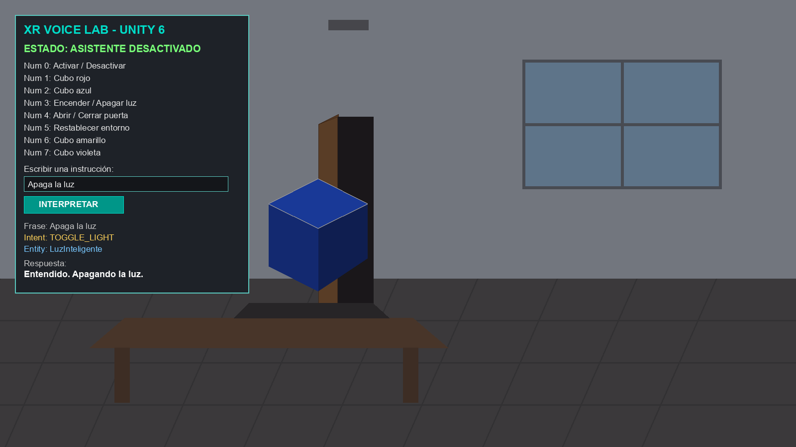

# XR Voice Lab — Unity 6

Laboratorio virtual en Unity 6 con un **asistente por voz simulado** que interpreta comandos en lenguaje natural (español) para controlar objetos de la escena: el color de un cubo, la luz del techo y una puerta.

**Autor:** Deyvi Sanchez
**Curso:** Laboratorio de Realidad Extendida (XR) para Videojuegos
**Actividad:** Semana 11



## ✨ Características

- **Interpretación de lenguaje natural (NLP simple):** normaliza el texto (minúsculas, sin tildes) y extrae *intents* (`CHANGE_COLOR`, `TOGGLE_LIGHT`, `CONTROL_DOOR`, `RESET_ENVIRONMENT`) y *entities*.
- **Colores soportados:** rojo, azul, verde, **amarillo** y **violeta** (nuevo).
- **Puerta animada:** la puerta se abre/cierra con una interpolación suave (`Quaternion.Slerp`) en lugar de girar instantáneamente (nuevo).
- **Panel de depuración en pantalla:** muestra estado, frase interpretada, intent, entity y respuesta del asistente.
- **Compatible con el nuevo Input System y el legado** (`#if ENABLE_INPUT_SYSTEM / ENABLE_LEGACY_INPUT_MANAGER`).
- Eventos `UnityEvent` (`alCambiarColor`, `alCambiarLuz`, `alMoverPuerta`) para extender sin tocar el código.
- Audio de confirmación opcional.

## 🎮 Controles

| Tecla | Acción |
|-------|--------|
| `Num 0` | Activar / desactivar el asistente |
| `Num 1` | Cubo rojo |
| `Num 2` | Cubo azul |
| `Num 3` | Encender / apagar la luz |
| `Num 4` | Abrir / cerrar la puerta |
| `Num 5` | Restablecer entorno |
| `Num 6` | Cubo amarillo |
| `Num 7` | Cubo violeta |

También podés escribir cualquier frase en el campo de texto y pulsar **INTERPRETAR COMANDO**, por ejemplo:

> "Abre la puerta y pon el cubo violeta" *(se procesa la primera intención detectada)*
> "Apaga la lámpara" · "Reinicia el entorno"

## 📸 Capturas

### Cambio de color y puerta animada


### Luz apagada


> Las imágenes de esta sección son ilustrativas (mockups generados del aspecto de la escena y el panel HUD).
## 🚀 Cómo ejecutarlo

1. Cloná el repo y abrí la carpeta del proyecto con **Unity 6+** (Unity Hub → Open → seleccionar la carpeta del proyecto).
2. Esperá a que Unity importe los paquetes y compile.
3. Abrí la escena `Assets/Scenes/SampleScene.unity`.
4. Pulsá **Play** y usá el teclado numérico o el campo de texto.

## 🗂️ Estructura

```
Assets/
├── Scenes/SampleScene.unity      # Escena principal
├── Scripts/AsistenteXRSimulado.cs # Lógica del asistente (NLP + acciones)
├── Material/                      # Materiales (cubo, puerta, suelo)
└── Audio/                         # Sonidos de confirmación
```

## 🛠️ Mejoras recientes

- Colores extra (amarillo, violeta) con atajos `Num 6` / `Num 7`.
- Animación suave de la puerta con corrutina y `Quaternion.Slerp`.
- Material del cubo con color base turquesa.

## 📄 Licencia

MIT
